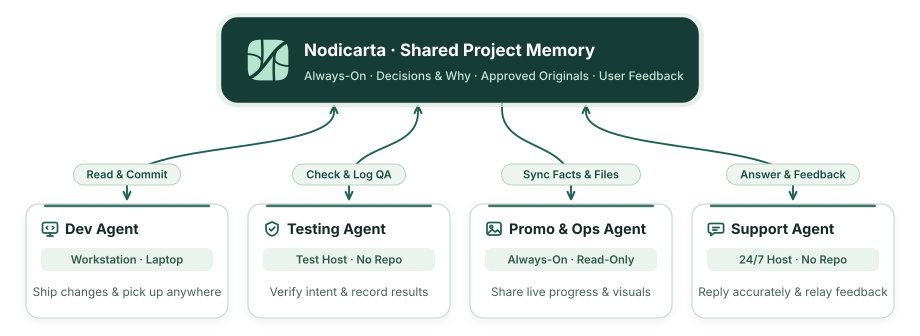

<h1 align="center">
  <picture>
    <source media="(prefers-color-scheme: dark)" srcset="src/ProjectHub.Core/wwwroot/brand-mark.svg">
    
  </picture>
  Nodicarta
</h1>

<p align="center">
  English · <a href="README.zh-CN.md">简体中文</a> · <a href="#getting-started">Quick start</a>
</p>

**When AI is capable across almost everything on a computer, we are not going to stop at using it to write code.**

Building a real product today goes far beyond engineering. Testing, visual assets, online promotion, and round-the-clock customer support can all be handled by AI agents.

At first, you might try running all of those agents on your main development machine. Reality gets in the way fast: **your desktop gets shut down at night, you grab a laptop to travel or work on the go, and your online promotion and customer support cannot afford to go offline with it.** Deploying dedicated agents onto separate hosts—each handling its own role continuously—quickly becomes the natural way to work.

That is right where the real pain begins:

- Newly deployed agents on other hosts don't have the source code and start knowing **nothing** about your project;
- You get stuck acting as a **human router**, copying background notes, product facts, images, and approved design files back and forth across machines;
- Worst of all, **every time development moves forward, the agents on every other device instantly fall behind**—engineering updates a rule or ships a change, while your promotion agent on another host is still pitching old behavior and your support agent is still giving users last week's answer, forcing you to make the rounds and re-align every machine by hand.

**Nodicarta was built to end that cycle: it gives your project an always-on, living shared memory that grows alongside your work—so agents across different machines stay in sync around the same project, without trapping you in the middle.**

<picture>
  <source media="(prefers-color-scheme: dark)" srcset="docs/design/workflow/workflow-en-dark.svg">
  
</picture>

---

## Why Existing "Agent Memory" Tools Don't Fit

There is no shortage of open-source projects about "AI memory," yet most are designed for a very different job: **helping a single assistant remember your personal preferences or fragments of past chats.**

Running development, promotion, support, and testing across multiple hosts around an evolving product brings a fundamentally different set of problems:

- **You don't need old chat fragments—you need every machine aligned on what is true right now**  
  A living project changes every day. Dumping raw conversation history into a search index mixes discarded ideas from last month, tentative guesses, and rules that just took effect today; the faster development moves, the easier it becomes for outward-facing agents to speak with confidence from outdated notes. Nodicarta distinguishes **active decisions, historical facts, verified observations, and open questions**—when a new decision supersedes an old one, other devices read what governs today while keeping the full trail of how the project got there.

- **Cross-machine work depends on images and approved originals, not just text**  
  Promotion agents need current brand marks, posters, and product visuals; operations and support need approved guides and reference files. Plain-text memory leaves files behind, and cannot tell the difference between "a file sitting in a folder" and "the exact version approved for this release." Nodicarta binds decisions, supporting evidence, and versioned originals together, so an authorized host without source code can trace why a file was chosen and download the exact original it needs.

- **Participants live beyond the codebase, yet each host needs clear boundaries**  
  A support or marketing agent running on an always-on server neither needs your source repository nor should ever have permission to alter project memory or peek into other projects. Nodicarta isolates everything by project: a computer without source code—even starting from an empty folder with read-only access—gets the context it needs, while untrusted prompts from external users cannot tamper with the project itself.

---

## How It Feels in Practice

- **Development moves forward; every other host stays in step**  
  Finish an iteration, revise a product boundary, or sign off on a new visual asset on your dev machine, and let your agent commit the conclusion, its evidence, and the original file to Nodicarta. When your promotion agent drafts copy or your support agent answers users on a remote server, they work directly from the updated reality—knowing clearly what has been verified and can be promised publicly, and what is still under evaluation.

- **Shut down, travel, or switch machines without breaking stride**  
  Power off your main workstation for the night while support and promotion keep running against the same project memory on an always-on host. Open your laptop on the road, start a fresh chat in a project folder, and your agent picks up right where your desktop left off—latest progress, past trade-offs, and open items intact—without re-explaining the backstory.

- **Real user voices flow straight back from the front line—not from scraping code-repo issues**  
  Many developers wire AI to watch GitHub Issues and auto-fix bugs, yet everyday users never open tickets in a source repository—their real friction, confusion, and requests surface in **live chats with online support agents** and **replies or inquiries around promotion**. Nodicarta lets frontline support and marketing agents send genuine user feedback—in the user's own words—straight back into the project as they serve people, routing it to the right development endpoint for bounded analysis; once investigated and resolved, the updated conclusion flows right back out so support gives the very next user an accurate answer.

---

## Long-Term Value

Models and client tools change every month, while a meaningful project lives for years. Nodicarta is built for what compounds over the long run:

### 1. Run an always-on, user-connected AI team—even as one builder or a small crew
Once AI can take on promotion, operations, testing, and support alongside engineering, the bottleneck is no longer whether AI can do any single job—it is **how agents spread across different machines stay coherent like one company**. Rather than another developer script orbiting a code repository, Nodicarta closes the loop **from product development all the way to real users on the front line**: whether your main machine is awake or you are away from your desk, product progress flows outward to promotion and support while real user feedback flows back to drive the next iteration—leaving direction and key decisions firmly in your hands.

### 2. Models and tools will keep turning over; project memory compounds
Every few months, the sharpest model and the best client tool change again. When your project's reasoning is trapped inside local sessions on individual machines, switching hardware or tools quietly resets your context to zero. When memory belongs to the project itself, models become interchangeable engines while your product trade-offs, user insights, approved originals, and hard-won boundaries accumulate year after year—the stronger future models become, the more leverage that accumulated memory delivers.

### 3. Answer tomorrow's unforeseen questions, not just sync today's status
Static handoff notes go stale the moment circumstances shift. Because Nodicarta preserves not only *what* was decided but *what evidence and constraints* drove that choice, an agent or collaborator joining six months or two years later can reason through situations nobody anticipated at the time—seeing which boundaries still hold, which assumptions have changed, and which open questions still call for your judgment.

### 4. Start solo across your own machines; grow naturally into shared team memory
Today, you can self-host Nodicarta to run multiple projects across your own devices with full ownership over data and access boundaries. As a project grows from one person to a team and across functions, that exact same project memory extends naturally into shared institutional context—so newcomers never have to piece history together from scratch, and instead build directly on what has already been learned.

---

## Getting Started

Core keeps your project memory, shared files and device permissions on an always-on host. Edge connects a local project folder to the AI client you use on each device, including Codex, Claude, Antigravity, Cursor and OpenCode.

**1. Install Core and its database.** On a Linux x86-64 machine with Docker Engine, the Docker Compose plugin and curl installed, run this command. It starts Core and PostgreSQL, generates the database credentials and connects Core to its database.

```sh
(installer=$(mktemp) && trap 'rm -f "$installer"' EXIT && curl -fsSL https://raw.githubusercontent.com/Yafeiml/nodikarta/main/deploy/public/install.sh -o "$installer" && sh "$installer")
```

**2. Open your Core web page.** When installation finishes, the terminal prints the web address and a one-time setup code. Open that address, enter the code and create your administrator account. Sign in and choose **Projects → Create project**.

**3. Connect your first device.** In Core, choose **Devices → Add device**, grant access to the project and generate a pairing code. Install Edge on the device where you use your AI client. Enter the Core address and the pairing code in Edge, then bind your project folder. [Download Edge](https://github.com/Yafeiml/nodikarta/releases/latest) · [Edge desktop guide](docs/operations/WINDOWS_EDGE_DESKTOP.en.md)

Record the first decision in a new project, or ask your assistant in an existing project folder, “Initialize this project's materials, and show me a preview first.”

- [Core deployment guide, external PostgreSQL and backups](deploy/public/README.md)
- **Go deeper**: [Bundled Skills](skills/) · [Core source](src/ProjectHub.Core/) · [Edge desktop source](src/ProjectHub.Edge.Desktop/) · [Edge MCP & CLI source](src/ProjectHub.Edge/)
- **License**: [MIT License](LICENSE)
