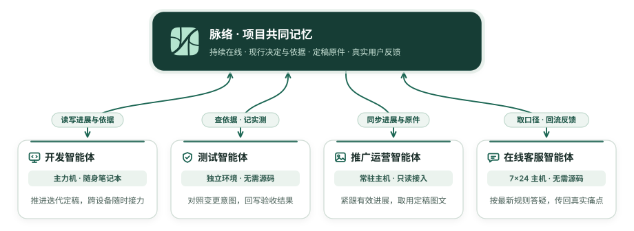

<picture>
  <source media="(prefers-color-scheme: dark)" srcset="src/ProjectHub.Core/wwwroot/brand-mark.svg">
  
</picture>

# 脉络 · Nodicarta

[English](README.md) · 简体中文

**当 AI 在计算机世界里已经接近全能，我们不可能只用它来写代码。**

今天做一个产品，除了研发本身，测试验收、视觉物料、线上的宣传推广、乃至全天候响应的客服支持，都可以交给智能体去完成。

起初，你也许试过把这些智能体全都开在自己的主力开发机上。但现实很快会提醒你：**主力电脑难免要关机，你也会带着笔记本出差、外出，而线上的推广与客服不能跟着断线。** 把承担不同职责的智能体部署到不同的主机上，让它们各司其职、持续运转，几乎是必然的选择。

可一旦分机部署，真正的痛点就来了：

- 新主机上的智能体没有源码，对你的项目**一无所知**；
- 你不得不变成一个**「人肉路由器」**，在几台机器之间来回搬运背景说明、业务数据、产品图片与定稿素材；
- 最让人难受的是，**开发进度只要往前推一步，其他设备上的智能体就立刻过时了**——研发刚改了规则、发了新版，另一台机器上的推广文案还在讲旧逻辑，客服还在拿上周的说法回答用户，你只能回过头一台台重新对齐。

**脉络（Nodicarta）正是由此而生：给项目建立一份独立在线、随演进同步生长的共同记忆，让分散在不同设备上的智能体围绕同一个项目同频工作，而不是把你困在中间反复传话。**

<picture>
  <source media="(prefers-color-scheme: dark)" srcset="docs/design/workflow/workflow-zh-dark.svg">
  
</picture>

---

## 为什么市面上的「智能体记忆」解决不了这件事

关于“给 AI 加记忆”的开源作品并不少，但绝大多数都在解决另一件事：**让单个助手在聊天时记住你的个人偏好或上文碎片。**

而当你把研发、推广、客服、测试分散到多台机器上，共同经营一个持续迭代的项目时，面对的是完全不同的矛盾：

- **你需要的不是“搜出旧聊天碎片”，而是“外围永远跟得上最新进展”**  
  项目每天都在变。如果只是把历史对话不分青红皂白地塞进检索库，上个月推翻的设想、临时的猜测和今天刚生效的决定就会混在一起；开发越往前走，外围智能体越容易拿着过期信息说错话。脉络区分**现行决定、历史事实、实测结果与尚未定论的问题**——新决定取代旧决定后，其他设备读到的就是此刻有效的结论，同时保留完整的来龙去脉。

- **跨机器协作要同步的不只是文字，还有图片与定稿原件**  
  宣传推广要取用最新的品牌标志、海报与产品配图，运营与客服需要查阅定稿文档。纯文本的记忆工具带不走文件，也分不清“某张图只是传到了文件夹里”和“这是团队正式拍板采用的版本”。脉络把决定、依据与原件版本锚定在一起，远端主机无需翻找聊天记录，就能直接查清缘由并下载对应的原件。

- **代码之外皆是参与者，但不同主机必须各守边界**  
  跑在线上服务器里的客服或推广智能体，既不需要克隆庞大的代码仓库，也不应该拥有修改项目记忆或查看其他项目的权限。脉络以「项目」为单位隔离一切资料：一台没有源码的电脑，哪怕只绑定一个空文件夹、只拿只读权限，也能完整读懂项目现状；同时杜绝外部用户的提问越权污染项目本身。

---

## 日常运转起来是什么样子

- **主力机往前推进，其他主机自动同频**  
  你在开发机上完成了功能迭代、改了业务边界，或是定稿了一版新视觉素材，顺手让智能体把结论、依据与原件记入脉络。远端服务器上的推广智能体准备宣传内容、客服智能体解答用户疑问时，读到的直接就是更新后的有效状态——清楚知道哪些能力已经实测落地可以对外承诺，哪些还在验证中不能把话说满。

- **关机、出差、换电脑，项目运转不断档**  
  夜里主力开发机关机休息，常驻主机上的客服与推广依然连着项目脉络正常工作；白天你带着笔记本外出，打开项目目录新建一次对话，智能体立刻就能接上主力机离开前的最新进展、历史取舍与待办事项，不需要你再把前因后果重敲一遍。

- **真实用户的声音从一线直达研发，而非定时去扫代码仓 Issues**  
  现在不少开发者会用 AI 全天候监控自己的 GitHub Issues 来提取和修复 Bug，但真正使用产品的普通用户根本不会跑去代码仓库提工单——他们真实的卡点、困惑与需求，全都发生在与**线上客服智能体的对话里**、在**宣传推广的评论与咨询互动中**。脉络让驻守一线的客服与推广智能体在接待用户的当口，就能把这些鲜活的真实用户反馈原样送回项目，交给开发端对应的职责入口做受控分析；等研发查明原因、完成迭代后，最新结论又自动回到脉络，让一线客服面对下一位用户时立刻给出准确回应。

---

## 这件事在未来的长期价值

工具和模型的形态每个月都在变，但一个真正有生命力的项目，往往要走过很长的时间。脉络真正看重的，是把时间拉长之后它所释放的长期价值：

### 1. 让一个人（或小团队）真正运转起一支全天候、直通真实用户的 AI 团队
当 AI 能够胜任开发之外的推广、运营、测试与客服，未来制约创造者的不再是“某一项活 AI 能不能干”，而是**分散在不同主机上的多个智能体如何像同一家公司那样同频呼吸**。不同于只围着代码仓库转的开发者脚本，脉络打通的是**从产品研发到真实市场一线的完整闭环**：无论你的主力机是否在线、人在不在桌前，开发成果能实时向外同步给推广与客服，一线接触到的真实用户声音又能顺着脉络反向推动演进，而你始终握住方向与关键改动的决定权。

### 2. 模型与工具注定不断更迭，唯有项目脉络持续复利
每隔几个月，市面上最强的模型、最顺手的客户端就会换一轮。如果项目的思考与资料散落在各台设备的本地会话里，每次换机器、换工具都是一次变相的“推倒重来”。当记忆独立归属于项目本身，模型就只是随时可替换的引擎；项目一路积累下来的产品取舍、用户洞察、定稿资产与经验边界会一年年沉淀下来——未来接入的模型越聪明，这份积累被放大的价值就越惊人。

### 3. 不仅能同步当下的进度，还能回答未来未知的抉择
死板的交接文档一旦遇到新情况就会失效。因为脉络留下的不只是“现在规定怎么做”，还有“当初基于什么证据做了这个取舍”，半年甚至两年后，无论是新部署的智能体还是新加入的伙伴，在面对过去从未预想过的新场景时，都能顺着来龙去脉做出贴合产品初衷的判断，并诚实指出哪些空白还需要你来拍板。

### 4. 从个人多机协同起步，自然生长为团队与组织的共同记忆
今天，你可以用完全自托管的方式，独自指挥多台设备上的智能体并行推进多个项目，数据与边界尽在掌握；往后，当项目从一个人走向一群人、从个人工作台走向跨部门协作时，同一条项目脉络无需推倒重来，就能平滑延展为整个团队的共同记忆——让后来者永远不必从零拼凑历史，而是站在已经看清的地方继续向前。

---

## 开始使用

脉络由两部分协同工作：**Core** 部署在一台持续在线的主机上，全天候守住各个项目的记忆、历史版本、共享原件与设备授权；**Edge** 安装在你的主力开发机、随身笔记本或远端业务主机上，把本地目录与你顺手的 AI 客户端（如 Codex、Claude、Antigravity、Cursor、OpenCode 等）接入获准的项目。

你可以从一个新项目记下第一条决定开始，也可以对已有项目直接说一句「初始化项目资料，先给我看看准备整理哪些内容」，让智能体先帮你梳理出项目的第一份脉络。

- **部署与接入**：[Core 部署指南](deploy/public/README.zh-CN.md) · [Windows 桌面端下载](https://github.com/Yafeiml/nodikarta/releases/latest) · [Edge 桌面使用说明](docs/operations/WINDOWS_EDGE_DESKTOP.md)
- **深入了解**：[内置通用 Skills](skills/) · [Core 源码](src/ProjectHub.Core/) · [Edge 桌面源码](src/ProjectHub.Edge.Desktop/) · [Edge MCP 与 CLI 源码](src/ProjectHub.Edge/)
- **开源许可**：[MIT 许可证](LICENSE)
